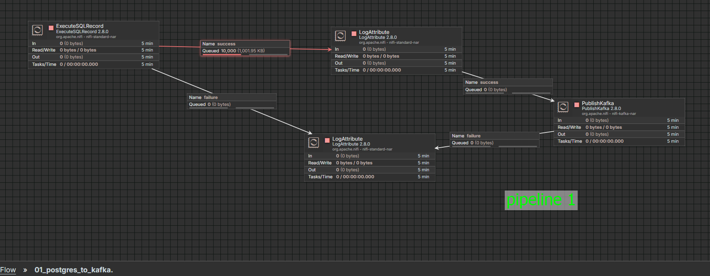
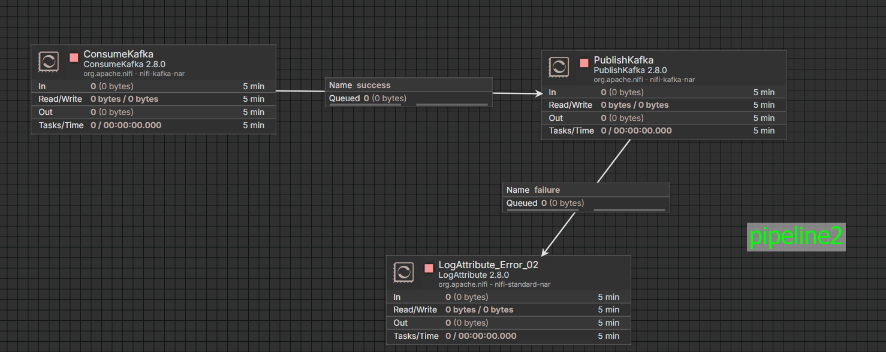
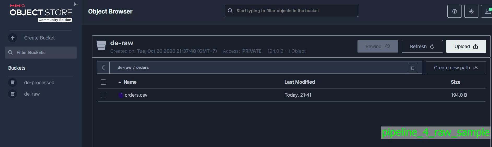
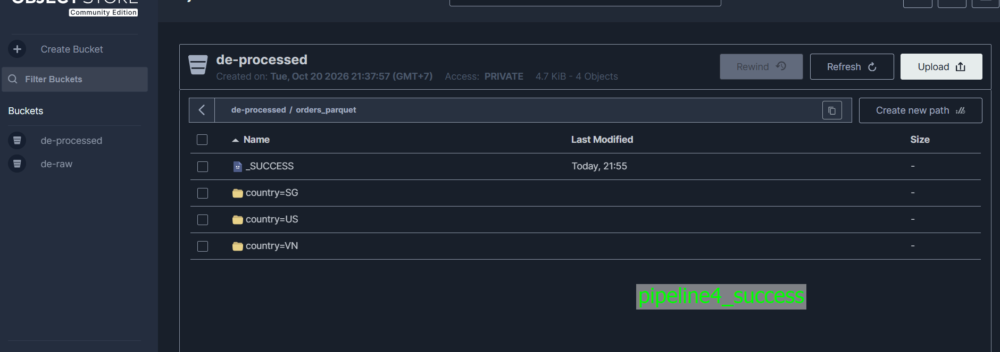

## Các luồng dữ liệu đã thực hành

### Pipeline 1: PostgreSQL ➔ NiFi ➔ Spark ➔ Kafka (`orders_raw_to_cleaned.py`)
- **Luồng dữ liệu:** NiFi đọc bảng `orders` từ PostgreSQL ➔ đẩy JSON thô vào Kafka topic `orders.raw` ➔ Spark Structured Streaming đọc từ `orders.raw`, ép kiểu dữ liệu, lọc bỏ bản ghi `NULL`/lỗi ➔ xuất JSON sạch ra topic `orders.cleaned`.
- **Kết quả:** Chạy kiểm thử chế độ `availableNow=True`, dữ liệu đã được làm sạch và chuyển tiếp thành công giữa hai topic Kafka.

### Pipeline 2: Kafka ➔ Spark ➔ PostgreSQL (`orders_staged_to_postgres.py`)
- **Luồng dữ liệu:** Spark đọc message từ Kafka topic `orders.staged` ➔ lọc đơn hàng hợp lệ (`status = 'completed'`, `amount > 0`) ➔ ghi micro-batch qua JDBC vào View `public.orders_processed_sink`.
- **Kết quả:** Kết hợp Trigger `INSTEAD OF INSERT` trên View trong PostgreSQL để thực hiện `UPSERT` vào bảng `orders_processed`.

### Pipeline 3: Kafka ➔ Spark (Enrichment) ➔ Kafka (`orders_stream_enrichment.py`)
- **Luồng dữ liệu:** Xử lý streaming liên tục (`processingTime="10 seconds"`). Đọc từ `orders.raw`, trích xuất metadata (`source_partition`, `source_offset`), gắn nhãn phân loại đơn hàng (`amount_category: high_value / standard`), thêm timestamp `processed_at` ➔ đẩy vào topic `orders.enriched` với message key là `order_id`.
- **Kết quả:** Kiểm thử streaming gần thời gian thực (near real-time), consumer đọc ra đúng schema và các trường đã làm giàu.

### Pipeline 4: MinIO (S3 CSV) ➔ Spark ➔ Parquet (`orders_csv_to_parquet.py`)
- **Luồng dữ liệu:** Spark kết nối MinIO qua giao thức Hadoop S3A ➔ đọc file `orders.csv` từ bucket `de-raw` ➔ lọc đơn hàng hợp lệ, chuẩn hóa `country` (uppercase, trim) ➔ ghi ra định dạng Parquet phân vùng theo thư mục `country` vào bucket `de-processed`.
- **Kết quả:** Đã đọc ngược lại thư mục Parquet để assert kiểm thử (`4` bản ghi hợp lệ), dữ liệu lưu trữ dạng columnar tối ưu dung lượng.

